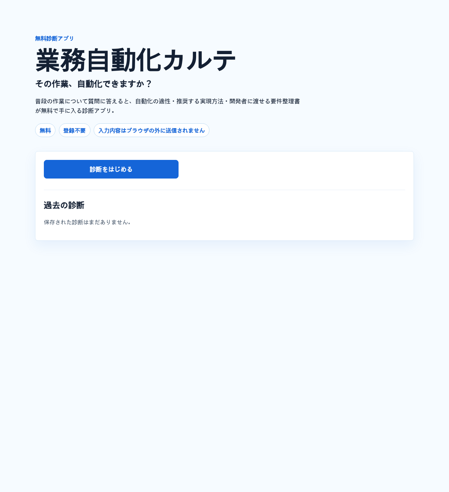

# 業務自動化カルテ

「その作業、自動化できますか？」をブラウザ上で診断する、完全静的な無料診断アプリです。入力内容はサーバーへ送信されず、診断結果はブラウザ内の履歴保存と Markdown ダウンロードで扱えます。



公開版はこちら → https://mamagotolab.com/automation-karte/

> このリポジトリは **ママゴトラボ** の公開テンプレートです。自社の業務に合わせたカスタマイズや、診断結果をもとにした開発のご相談も承っています（[ご相談はこちら](#カスタマイズのご相談)）。

## セットアップ

依存は `vite` と `vitest` のみです。追加インストールや外部通信は不要です。

```bash
npm test
npm run build
npm run dev
```

ビルド後の確認は次のコマンドで行えます。

```bash
npm run preview
```

## 機能一覧

- 業務メモの任意入力
- 仕様書どおりの12問診断
- 必須質問の未回答チェックと該当位置へのスクロール
- 自動化適性（高・中・低）のルールベース診断
- 自動化できる部分、人が担当する部分の整理
- 推奨する実現方法の提示
- 月あたり作業時間と削減時間の試算
- 開発に必要な資料と注意点の提示
- 診断結果の Markdown ダウンロード
- 診断結果のコピー
- 印刷用表示
- localStorage による過去診断の保存、再表示、削除

## 非エンジニア向け説明

このアプリは、普段の作業について質問に答えるだけで「自動化しやすい作業か」「どんな方法が向いているか」「相談前にどんな資料を用意するとよいか」を整理します。

入力した内容はブラウザの外に送信されません。診断結果はその場で表示され、必要に応じて Markdown ファイルとして保存できます。出力されたカルテは、開発者への相談や見積もり依頼にそのまま使える整理書です（診断結果はあくまで一次診断です。確定見積もりには実際の資料をもとにした確認が必要です）。

---

## カスタマイズのご相談

「自社の業務に合わせた診断項目にしたい」「診断結果をもとに、そのまま開発まで頼みたい」といったご相談を承っています。
業務の流れを整理する**要件定義**から、運用後の**保守**まで対応します。

- ホームページ：https://mamagotolab.com
- ご依頼（クラウドワークス）：https://crowdworks.jp/public/employees/6942778

## ライセンス

MIT License. 自由に利用・改変できます。
